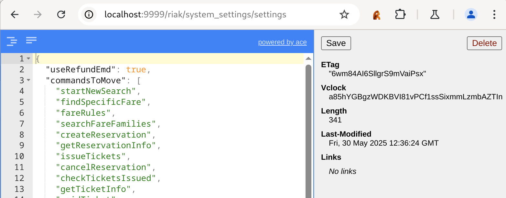
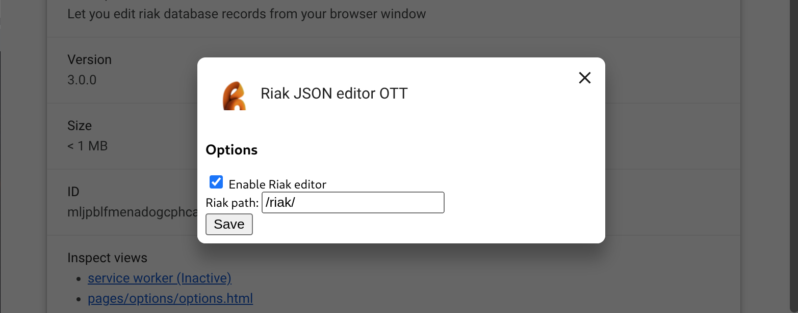

# Riak JSON Editor OTT

**Версия:** 3.0.0

Расширение для браузера (✔️ Chrome / 🚧 Firefox) для интерактивного редактирования JSON-записей в базе данных Riak прямо из окна браузера.

## Возможности

- Редактирование JSON-объекта
- Просмотр метаданных (ETag, Vclock, Content-Length, Last-Modified)
- Просмотр ссылок (Link headers) и переходов по ним
- Сохранение изменений через HTTP PUT
- Удаление записи через HTTP DELETE
- Настройки: пути и включения/отключения расширения




## Установка

1. Клонируйте репозиторий:
   ```bash
   git clone <URL_репозитория>
   ```
2. Откройте страницу расширений в вашем браузере:
   - Chrome: `chrome://extensions`
   - 🚧 Firefox: `about:debugging#/runtime/this-firefox`
3. Включите режим разработчика.
4. Нажмите **Загрузить распакованное расширение** и укажите корневую папку этого репозитория.

## Настройки

- Перейдите на страницу опций расширения:
  - Chrome: нажмите **Details → Extension options**.
  - Firefox: нажмите **Настройки** для расширения.
- Включите или отключите расширение.
- Укажите префикс пути к Riak (по умолчанию `/riak/`).

## Использование

1. Перейдите в браузере по адресу вашего Riak-кластера, например:
   ```
   http://<host>:<port>/riak/<bucket>/<key>
   ```
2. Расширение автоматически отобразит JSON-редактор и панель метаданных.
3. Внесите изменения в JSON и нажмите **Save** для сохранения.
4. При необходимости нажмите **Delete** для удаления записи.

## Зависимости

- [JSONEditor](https://github.com/josdejong/jsoneditor) (Apache 2.0) — визуальный редактор JSON.
- [Mustache](https://github.com/janl/mustache.js) — шаблонизатор.

## Сборка

Сборка не требуется: после загрузки распакованного расширения все файлы готовы к использованию.
